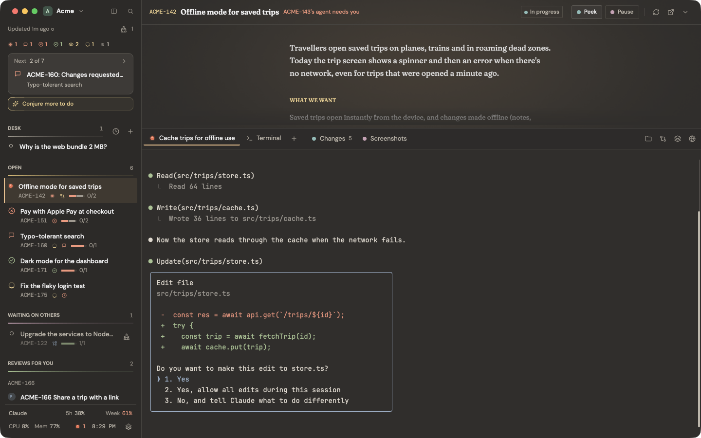
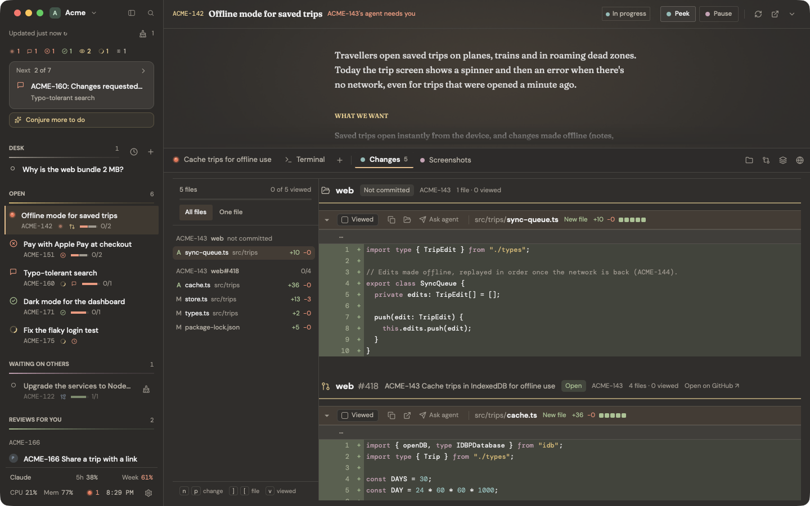
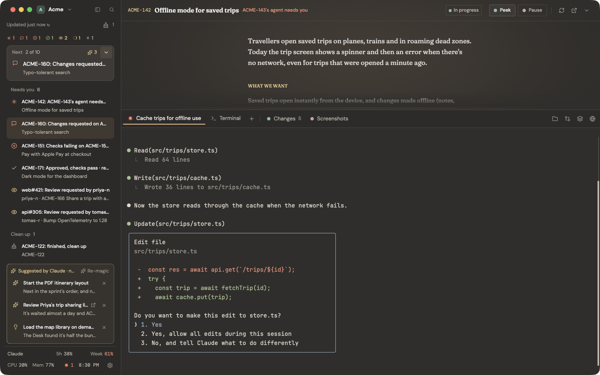
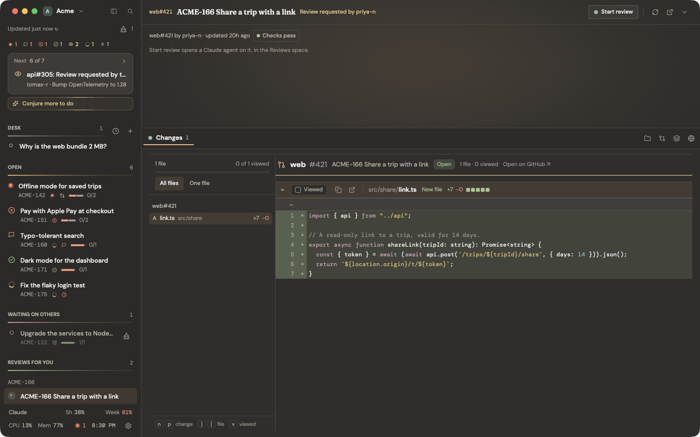
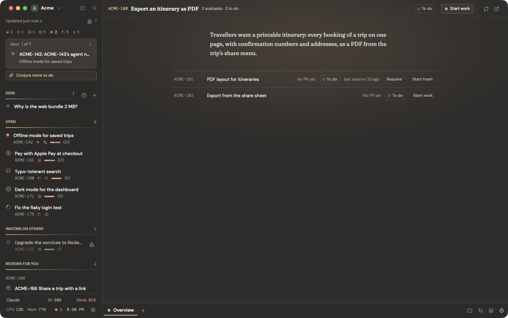
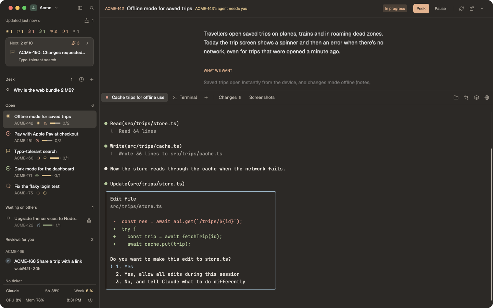

# Kelpie

A kelpie is the sheepdog that works the flock on its own and comes back only when it's needed. This one does the same for your Claude agents in Herdr.

Layouts and mods for Herdr built around profiles and stories: a profile's Jira sprint in the sidebar, each story as a Herdr space with its Claude agents, its pull requests, changes and screenshots, and a browser panel per profile.

- `layouts/Kelpie.json` (the Quiet Pages look) and `layouts/Kelpie-Plain.json` (no skin), with their themes and previews
- `mods/kelpie`: every Kelpie view (sidebar, story header, Changes, tab bar, footer, dialogs, skins)
- `mods/kelpie-artifacts`: the Artifacts panel and the Screenshots view



## A look around

Each story's pull requests and uncommitted work, file by file, with a review's progress kept as you go:



Next takes you to whatever needs you, most urgent first. Claude can add its own picks from the sprint, the reviews waiting on you and the repos you work in:



A review waiting for you, before any agent starts on it:



A story nobody has started yet:



`Kelpie-Plain` is the same layout without the skin:



## Requirements

- Herdr and [Claude Code](https://claude.com/claude-code)
- `git`, `python3`, `jq` and `curl`
- For pull requests: the GitHub CLI `gh`, signed in (`gh auth login`)
- For Jira (Jira Cloud only): an API token, kept in the macOS Keychain or printed by a command of your own (`op read …`, `pass …`, `secret-tool lookup …`); the profile dialog sets it up
- Optional: `terminal-browser` for the Web panel; `sqlite3` lets Restart browser forget a stuck page

Developed on macOS. Linux is meant to work (no Keychain: use a token command) but is less tested.

## Install

```sh
./install.sh
```

Then merge the sections of `keys.json` into `~/.config/herdr-app/keys.json`, and pick a Kelpie layout (`cmd-shift-l`). Profiles (folder, Jira board, GitHub owner, Claude account) are set up from the sidebar's profile menu, or by a Claude agent with "Let me configure it for you".

Optional:

- Claude limits in the footer: set Claude Code's status line to `sh ~/.config/herdr-app/mods/kelpie/claude-statusline.sh`
- The web panel needs `terminal-browser` and, for its images, `terminal-browser config set render.presenter patched` once
- Skins with art: `python3 mods/kelpie/skins/<name>/build.py` (needs pillow) where a skin has one

## Try it without Jira

```sh
herdr-app do kelpie.demo
```

This adds a profile called Acme, with a made-up sprint, pull requests and agents in every state, and opens its stories as spaces. Nothing reaches Jira, GitHub or Claude. Its agents are a stand-in script, and its links go nowhere real. What it shows comes from `mods/kelpie/demo/demo.json`: edit it and press Refresh to set up another situation. When you're done, close the Acme spaces and delete the profile from its profile dialog.

See `CLAUDE.md` for how it all works.

## License

MIT, see `LICENSE`. Bundled third-party files keep their own licences, kept beside them:

- Icons in `mods/kelpie/icons/`: [Lucide](https://lucide.dev), ISC (`mods/kelpie/icons/LICENSE`)
- Fonts in `mods/kelpie/skins/quiet-pages/fonts/`: DM Sans, DM Mono and Fraunces, SIL Open Font License 1.1 (`OFL-*.txt` there)
